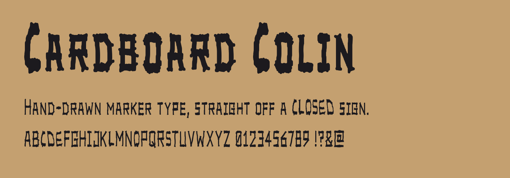
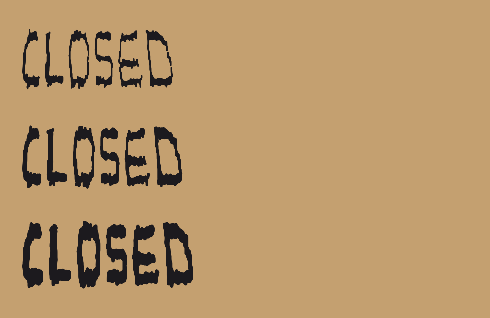
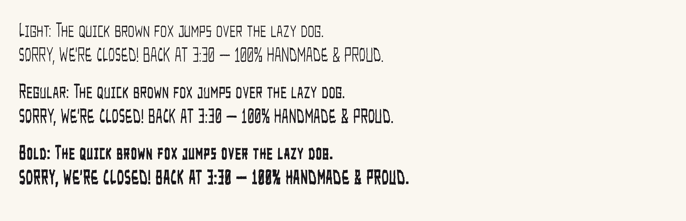

# Cardboard Colin



A shaky, condensed marker font grown from a single hand-drawn **CLOSED** sign that Colin
made on a piece of cardboard. The letters **C L O S E D** are traced straight from the
photo; everything else was drawn to match: same marker width, same narrow proportions,
same wobbly, re-inked edges.

- **Weights:** Light (300), Regular (400), Bold (700)
- **Formats:** OTF, TTF, WOFF2
- **Characters:** A–Z, lowercase as small caps, 0–9, punctuation and symbols,
  quotes and dashes, € £ ¥ ¢, and accented Latin vowels (À–Ý / à–ý, Ñ ñ)
- **Kerning:** automatic, profile-based
- **License:** [SIL Open Font License 1.1](OFL.txt), free for personal and commercial use

**Specimen and type tester:** https://dadardy.github.io/cardboard-colin/




## Make a sign

The website has a sign maker. You type straight onto a cardboard sign, then drag its edges or
corners (mouse or touch) to make it any size from 2 to 48 inches. The words reflow and grow to fit,
or you can set the text size yourself. Letter, A4, Tabloid, Square and Banner sizes are one-click
snaps. Pick a weight, alignment and colours, then print it or download PDF, SVG, PNG or Word at
the sign's size, or fitted onto Letter, A4 or Tabloid paper. PDF and SVG use outlined vector
letters, so they work without the font installed.

## How the letters are made

Every glyph is inked by a simulated marker, the way Colin drew his sign: a round nib scribbles
up and down while moving along each stroke. Each pass spans the stroke's height at that point, so
stems get long passes, horizontal bars get many short ones and diagonals land in between. The
spacing and reach of each pass vary a little (more on horizontals, with the occasional gap where
the cardboard shows through). `scripts/marker.py` has the model; `specimen/photo-vs-font.png`
compares it with Colin's original letters.

## Status

Version 2.0.0. Light, Regular and Bold; Latin capitals, small-cap lowercase, digits, punctuation and common accented letters.

## Install on your computer

1. Download [CardboardColin-v2.0.0.zip](https://dadardy.github.io/cardboard-colin/downloads/CardboardColin-v2.0.0.zip)
   (also attached to the [v2.0.0 release](https://github.com/dadardy/cardboard-colin/releases/tag/v2.0.0)).
2. Open `fonts/otf` (or `fonts/ttf`) and double-click each file, then click **Install**
   (macOS Font Book / Windows). On Linux, copy the files to `~/.local/share/fonts`.

## Use it on the web

The fastest option is jsDelivr, which serves files straight from this repo:

```html
<link rel="stylesheet" href="https://cdn.jsdelivr.net/gh/dadardy/cardboard-colin@v2.0.0/css/cardboard-colin.css">
<style>
  h1, .sign { font-family: "Cardboard Colin", sans-serif; font-weight: 700; }
</style>
```

Or write the `@font-face` rules yourself:

```css
@font-face {
  font-family: "Cardboard Colin";
  src: url("https://cdn.jsdelivr.net/gh/dadardy/cardboard-colin@v2.0.0/fonts/woff2/CardboardColin-Regular.woff2") format("woff2");
  font-weight: 400;
  font-display: swap;
}
@font-face {
  font-family: "Cardboard Colin";
  src: url("https://cdn.jsdelivr.net/gh/dadardy/cardboard-colin@v2.0.0/fonts/woff2/CardboardColin-Bold.woff2") format("woff2");
  font-weight: 700;
  font-display: swap;
}
```

Light is weight `300`, using `CardboardColin-Light.woff2`.

## How it's made

Everything is reproducible from the photo in `source/closed-sign.png`:

1. **Extract:** `scripts/render.py` thresholds the photo, finds the six letters, fills
   pinholes and scales them to a 700-unit cap height.
2. **Design:** `scripts/glyphdefs.py` describes every other glyph as centre-line strokes,
   widened to the marker width measured on the sign. Horizontal strokes come out a little
   taller than stems are wide, just like Colin's up-and-down scribble.
3. **Ink like a marker:** `scripts/marker.py` fills every stroke shape with vertical
   up-and-down passes of a round nib. Where each pass turns around you get the little
   scallops on the tops and bottoms of strokes; stems stay smooth. Colin's own six letters
   are smoothed back to their shapes and re-inked the same way (his heavy L is slimmed to
   match the others).
4. **Weights:** Light, Regular and Bold use a thinner or thicker stroke *and* nib, so every
   weight is drawn with the same up-and-down motion.
5. **Trace and build:** potrace vectorises each bitmap; `scripts/build.py` cleans the
   outlines with skia-pathops, works out kerning from the glyph shapes, and writes
   OTF/TTF/WOFF2 with fontTools. `scripts/specimen.py` renders the PNGs.

```sh
python3 -m venv .venv && . .venv/bin/activate
pip install -r requirements.txt
make            # fonts + specimens
make zip        # release zip in dist/
```

## Credits

Lettering by Colin. Font by Colin & Ryan, 2026.
